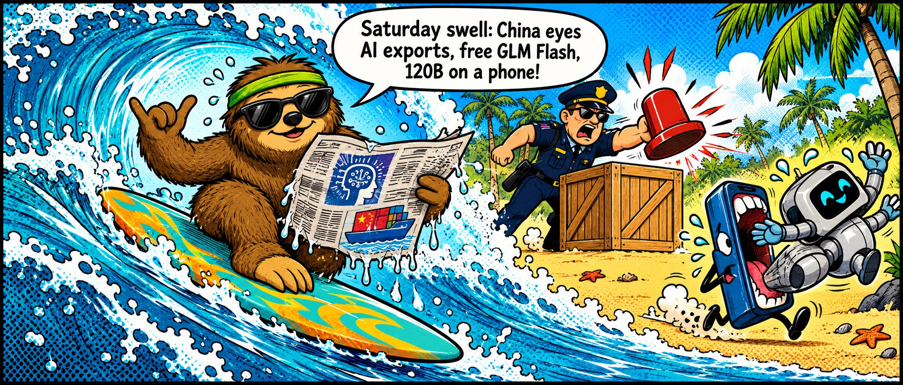
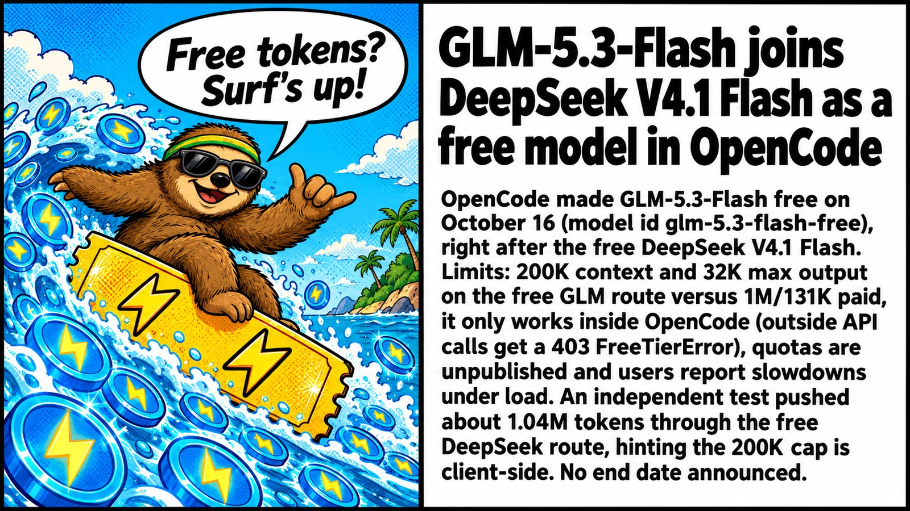
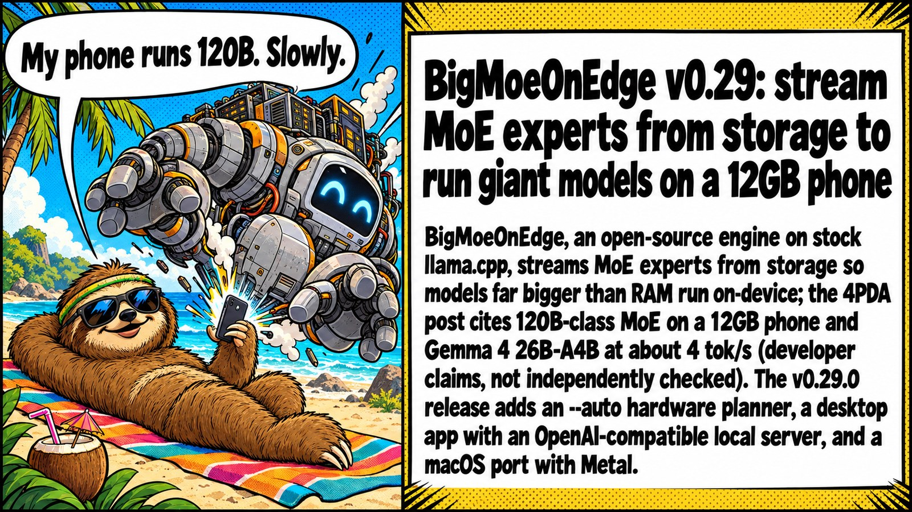
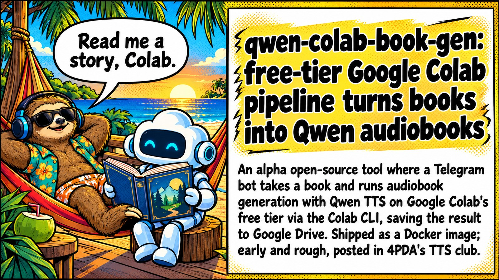

# 🤖 AI News Digest

Daily AI news from [4PDA's AI forum](https://4pda.to/forum/index.php?showforum=1240), curated with r/LocalLLaMA energy 🦾. Updated every day at 9:17 AM (UTC+7).

📅 **2026-10-17** · Mascot of the day: **Sid the Surfing Sloth 🦥🏄**

See also: [🗓️ Top of the week](weekly.md) · [📆 Top of the month](monthly.md)

📰 **TL;DR:** China drafts export controls on frontier AI models, agents and compute clusters · GLM-5.3-Flash joins DeepSeek V4.1 Flash as a free model in OpenCode · BigMoeOnEdge v0.29: stream MoE experts from storage to run giant models on a 12GB phone 🔥🤯

1.  **[China drafts export controls on frontier AI models, agents and compute clusters](https://4pda.to/forum/index.php?showtopic=1111449&view=findpost&p=145543492)** 🇨🇳📦 Beijing puts frontier weights on the export list. Open-source carve-out is the whole ballgame, read the fine print before you panic 🧐
2.  **[GLM-5.3-Flash joins DeepSeek V4.1 Flash as a free model in OpenCode](https://4pda.to/forum/index.php?showtopic=1123739&view=findpost&p=145544806)** 🆓🤖 Two free Flash models in one week. OpenCode is speedrunning customer acquisition, this is the way 🏃
3.  **[BigMoeOnEdge v0.29: stream MoE experts from storage to run giant models on a 12GB phone](https://4pda.to/forum/index.php?showtopic=1115552&view=findpost&p=145540527)** 📱🐘 120B on a phone via SSD streaming. 4 tok/s is slow but it's YOUR 4 tok/s. Benchmarks or it didn't happen 👀
4.  **[Unofficial native OpenCode port for Android ships with a built-in Linux shell](https://4pda.to/forum/index.php?showtopic=1124028&view=findpost&p=145535683)** 🤳💻 Coding agent in your pocket, terminal included. Pair it with the free Flash models and vibe-code on the bus 🚌
5.  **[qwen-colab-book-gen: free-tier Google Colab pipeline turns books into Qwen audiobooks](https://4pda.to/forum/index.php?showtopic=1110815&view=findpost&p=145536910)** 📚🎧 Free Colab GPUs reading you bedtime stories. Alpha energy, expect jank 🛠️
