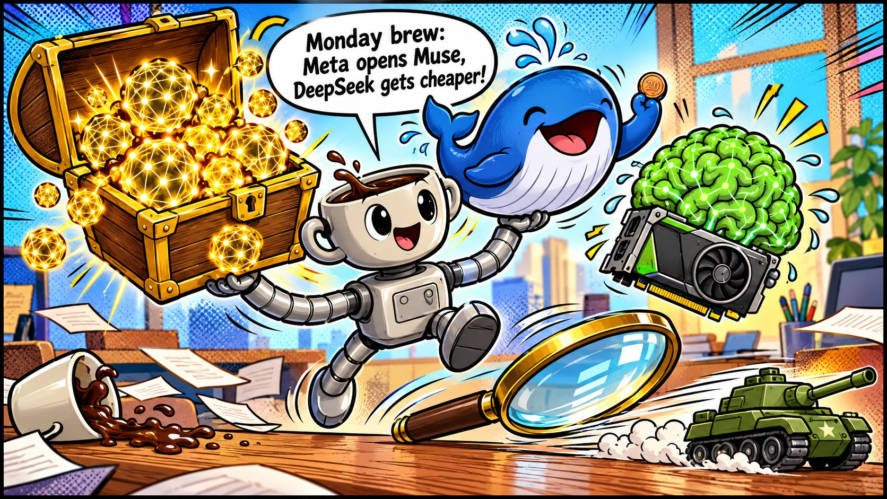
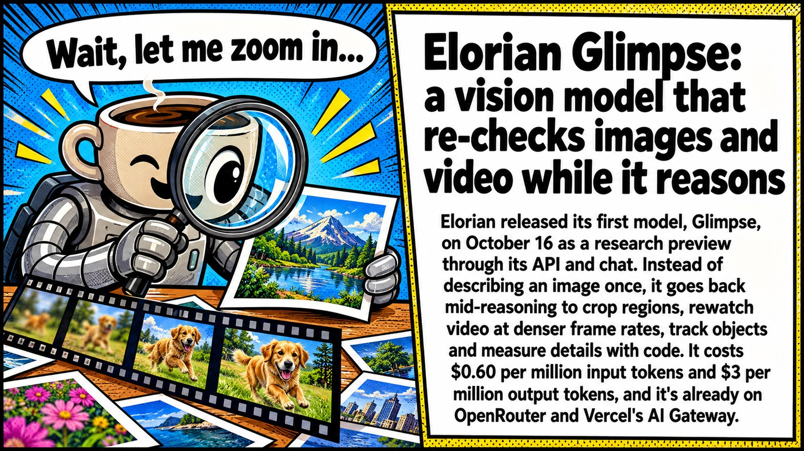
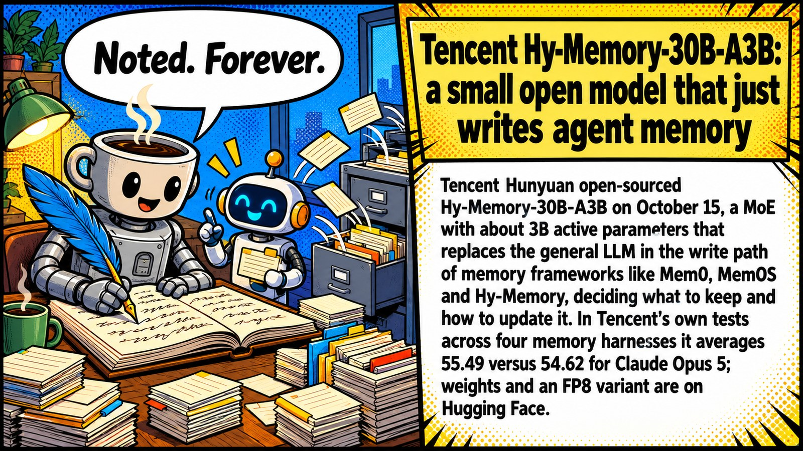
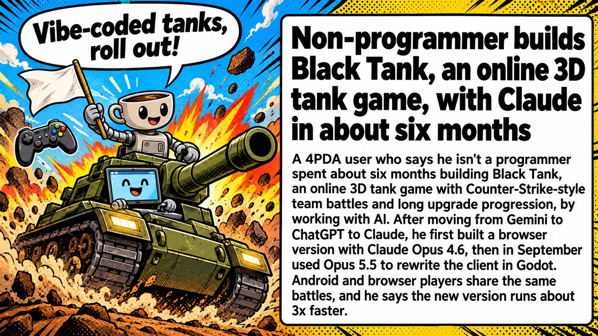

# 🤖 AI News Digest

Daily AI news from [4PDA's AI forum](https://4pda.to/forum/index.php?showforum=1240), curated with r/LocalLLaMA energy 🦾. Updated every day at 9:17 AM (UTC+7).

📅 **2026-10-19** · Mascot of the day: **Moe the Coffee Robot ☕🤖**

See also: [🗓️ Top of the week](weekly.md) · [📆 Top of the month](monthly.md)

📰 **TL;DR:** Meta's Muse Spark Open: 816B-A42B open weights for coding agents, runs on two Mac Studios · DeepSeek-V4.1-Flash-1017: open-weight update with cheaper agent runs and a public Search API · NVIDIA Nemotron 3.5: Super VL 120B-A12B and a 2-bit Bolt model that fits in 24 GB 🔥🤯

1.  **[Meta's Muse Spark Open: 816B-A42B open weights for coding agents, runs on two Mac Studios](https://4pda.to/forum/index.php?showtopic=1111449&view=findpost&p=145561560)** 🧠🔓 816B open weights from Meta. Hope you've got two Mac Studios and a spare kidney 💸 GGUFs or it didn't happen 👀
2.  **[DeepSeek-V4.1-Flash-1017: open-weight update with cheaper agent runs and a public Search API](https://4pda.to/forum/index.php?showtopic=1111449&view=findpost&p=145561560)** 🐋💸 77 on DeepSWE for twenty cents a task, per DeepSeek's own chart. Independent evals or it didn't happen 🧐
3.  **[NVIDIA Nemotron 3.5: Super VL 120B-A12B and a 2-bit Bolt model that fits in 24 GB](https://4pda.to/forum/index.php?showtopic=1111449&view=findpost&p=145561560)** 🟩🗜️ 74B squeezed to 2 bits so it fits a 24 GB card. Your 3090 just got a second wind 🔥
4.  **[Elorian Glimpse: a vision model that re-checks images and video while it reasons](https://4pda.to/forum/index.php?showtopic=1111449&view=findpost&p=145561560)** 👁️🔍 A model that actually looks twice before answering. More than most Redditors do 😏
5.  **[Tencent Hy-Memory-30B-A3B: a small open model that just writes agent memory](https://4pda.to/forum/index.php?showtopic=1111449&view=findpost&p=145561701)** 🧠📝 A dedicated memory scribe for your agent. Finally something that remembers your preferences 🗃️
6.  **[Non-programmer builds Black Tank, an online 3D tank game, with Claude in about six months](https://4pda.to/forum/index.php?showtopic=1077922&view=findpost&p=145572453)** 🎮🛡️ Six months of vibe-coding and it's a real multiplayer tank game in Godot. This is the way 🫡
