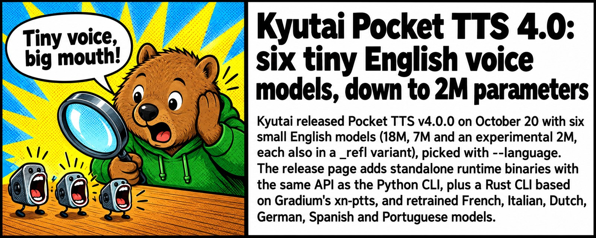

# 🤖 AI News Digest

Daily AI news from [4PDA's AI forum](https://4pda.to/forum/index.php?showforum=1240), curated with r/LocalLLaMA energy 🦾. Updated every day at 9:17 AM (UTC+7).

📅 **2026-10-21** · Mascot of the day: **Wally the Wombat 🐨**

See also: [🗓️ Top of the week](weekly.md) · [📆 Top of the month](monthly.md)

📰 **TL;DR:** Kyutai Pocket TTS 4.0: six tiny English voice models, down to 2M parameters 🔥🤯

1.  **[Kyutai Pocket TTS 4.0: six tiny English voice models, down to 2M parameters](https://4pda.to/forum/index.php?showtopic=1110815&view=findpost&p=145608269)** 🗣️🤏 A 2M-param voice model. Your toaster is about to start reading you audiobooks. Blind listening tests or it didn't happen 👀
