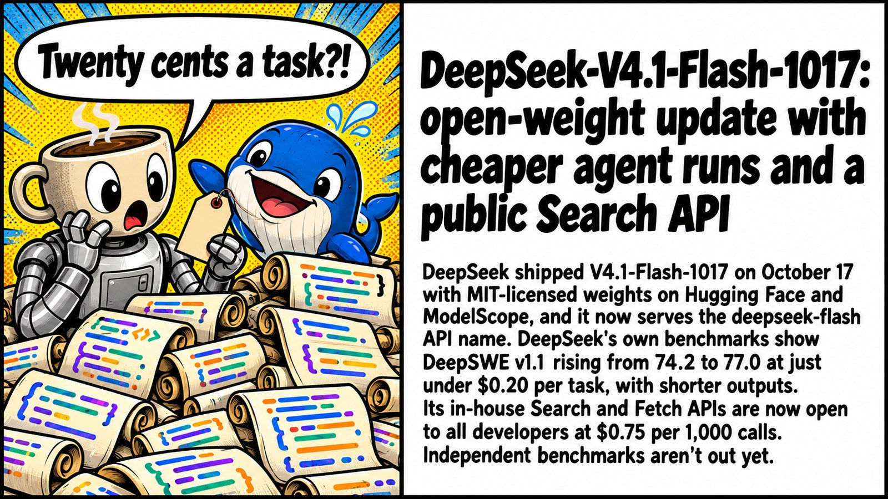
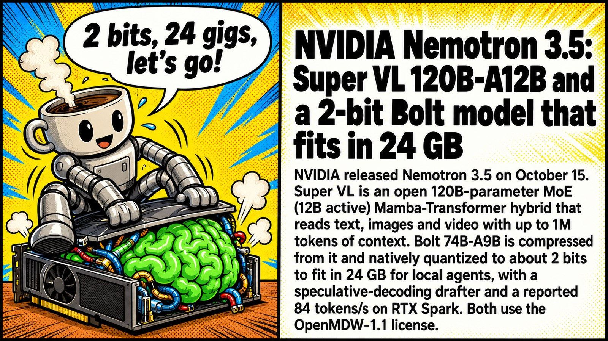

# 🗓️ Top of the week

Last 7 days up to 2026-10-21 (by publication date). [⬅️ Today](README.md)

📰 **TL;DR:** FLUX 3 Image Klein: 5.6B open weights for text-to-image, editing, and layout boxes · Meta's Muse Spark Open: 816B-A42B open weights for coding agents, runs on two Mac Studios · OpenCode makes DeepSeek V4.1 Flash free (limited time, ~200K context on Zen) 🔥🤯

1.  **[FLUX 3 Image Klein: 5.6B open weights for text-to-image, editing, and layout boxes](https://4pda.to/forum/index.php?showtopic=1112313&view=findpost&p=145531159)** 🎨 Finally, FLUX 3 you can actually download. 5.6B, open weights, layout boxes — localbros rejoice 🔥
2.  **[Meta's Muse Spark Open: 816B-A42B open weights for coding agents, runs on two Mac Studios](https://4pda.to/forum/index.php?showtopic=1111449&view=findpost&p=145561560)** 🧠🔓 816B open weights from Meta. Hope you've got two Mac Studios and a spare kidney 💸 GGUFs or it didn't happen 👀
3.  **[OpenCode makes DeepSeek V4.1 Flash free (limited time, ~200K context on Zen)](https://4pda.to/forum/index.php?showtopic=1077922&view=findpost&p=145520261)** 💸 DeepSeek V4.1 Flash went freemium on OpenCode. Grab it before the "limited time" ends 🏃‍♂️
4.  **[DeepSeek-V4.1-Flash-1017: open-weight update with cheaper agent runs and a public Search API](https://4pda.to/forum/index.php?showtopic=1111449&view=findpost&p=145561560)** 🐋💸 77 on DeepSWE for twenty cents a task, per DeepSeek's own chart. Independent evals or it didn't happen 🧐
5.  **[China drafts export controls on frontier AI models, agents and compute clusters](https://4pda.to/forum/index.php?showtopic=1111449&view=findpost&p=145543492)** 🇨🇳📦 Beijing puts frontier weights on the export list. Open-source carve-out is the whole ballgame, read the fine print before you panic 🧐
6.  **[NVIDIA Nemotron 3.5: Super VL 120B-A12B and a 2-bit Bolt model that fits in 24 GB](https://4pda.to/forum/index.php?showtopic=1111449&view=findpost&p=145561560)** 🟩🗜️ 74B squeezed to 2 bits so it fits a 24 GB card. Your 3090 just got a second wind 🔥
7.  **[MOSS-Image: OpenMOSS open-sources a 5B image model that places text and objects by bounding box](https://4pda.to/forum/index.php?showtopic=1112313&view=findpost&p=145557652)** 📐🖼️ Bounding boxes AND readable text, Apache-2.0. FLUX Klein just got a roommate. Side-by-sides or it didn't happen 👀
8.  **[PS5LM Plus: Qwen 3.8 27B at ~20 tok/s on a jailbroken PS5's GPU](https://4pda.to/forum/index.php?showtopic=1077922&view=findpost&p=145518615)** 🎮 Your PS5 just became a 27B inference box. Jailbreak tax applies 💀
9.  **[GLM-5.3-Flash joins DeepSeek V4.1 Flash as a free model in OpenCode](https://4pda.to/forum/index.php?showtopic=1123739&view=findpost&p=145544806)** 🆓🤖 Two free Flash models in one week. OpenCode is speedrunning customer acquisition, this is the way 🏃
10.  **[Vecta v0.1.0: open-source Mac app turns PLAUD recorders into fully local AI](https://4pda.to/forum/index.php?showtopic=1077922&view=findpost&p=145518729)** 🎙️ PLAUD without the 300-minute tax. Mac does the AI, recorder just records ✨
