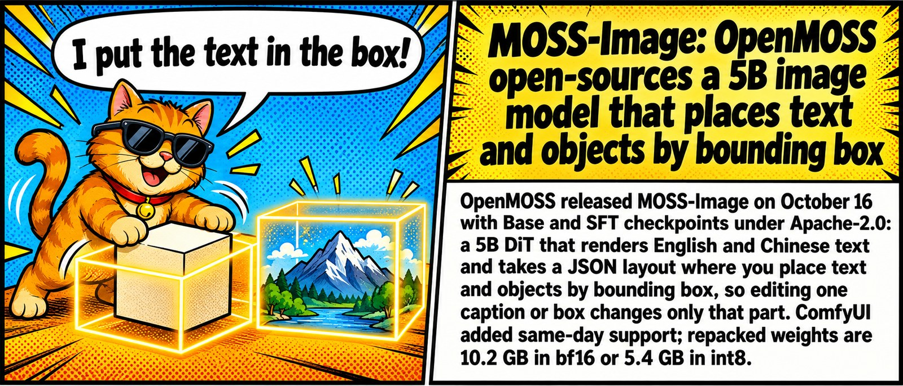

# 🗓️ Top of the week

Last 7 days up to 2026-10-18 (by publication date). [⬅️ Today](README.md)

📰 **TL;DR:** OmGithub: discover and play open-source AI projects instantly · FLUX 3 Image Klein: 5.6B open weights for text-to-image, editing, and layout boxes · OpenCode makes DeepSeek V4.1 Flash free (limited time, ~200K context on Zen) 🔥🤯

1.  **[OmGithub: discover and play open-source AI projects instantly](https://omgithub.com)** 🚀 Every open-source AI project, playable in one click. No git clone, no npm install, just vibes. This is the way 🫡
2.  **[FLUX 3 Image Klein: 5.6B open weights for text-to-image, editing, and layout boxes](https://4pda.to/forum/index.php?showtopic=1112313&view=findpost&p=145531159)** 🎨 Finally, FLUX 3 you can actually download. 5.6B, open weights, layout boxes — localbros rejoice 🔥
3.  **[OpenCode makes DeepSeek V4.1 Flash free (limited time, ~200K context on Zen)](https://4pda.to/forum/index.php?showtopic=1077922&view=findpost&p=145520261)** 💸 DeepSeek V4.1 Flash went freemium on OpenCode. Grab it before the "limited time" ends 🏃‍♂️
4.  **[China drafts export controls on frontier AI models, agents and compute clusters](https://4pda.to/forum/index.php?showtopic=1111449&view=findpost&p=145543492)** 🇨🇳📦 Beijing puts frontier weights on the export list. Open-source carve-out is the whole ballgame, read the fine print before you panic 🧐
5.  **[Cat Jam Free: stealth coding model on OpenCode Zen](https://4pda.to/forum/index.php?showtopic=1077922&view=findpost&p=145501804)** 🐱🎸 Free 262K coding stealth model just dropped on OpenCode Zen. Dev won't say who cooked it, rumor mill says Xiaomi MiMo — benchmarks or it didn't happen 👀
6.  **[MOSS-Image: OpenMOSS open-sources a 5B image model that places text and objects by bounding box](https://4pda.to/forum/index.php?showtopic=1112313&view=findpost&p=145557652)** 📐🖼️ Bounding boxes AND readable text, Apache-2.0. FLUX Klein just got a roommate. Side-by-sides or it didn't happen 👀
7.  **[PS5LM Plus: Qwen 3.8 27B at ~20 tok/s on a jailbroken PS5's GPU](https://4pda.to/forum/index.php?showtopic=1077922&view=findpost&p=145518615)** 🎮 Your PS5 just became a 27B inference box. Jailbreak tax applies 💀
8.  **[Phone Harness: Hermes Agent can now drive your iPhone and Android](https://4pda.to/forum/index.php?showtopic=1123739&view=findpost&p=145502480)** 📱🤖 Your agent now has thumbs. Taps, types, checks its own work on a real phone, no app APIs needed. What could possibly go wrong 💀
9.  **[GLM-5.3-Flash joins DeepSeek V4.1 Flash as a free model in OpenCode](https://4pda.to/forum/index.php?showtopic=1123739&view=findpost&p=145544806)** 🆓🤖 Two free Flash models in one week. OpenCode is speedrunning customer acquisition, this is the way 🏃
10.  **[Hermes Agent v0.22.0 'Threshold': no-key first chat, local llama.cpp, 600 vetted plugins](https://4pda.to/forum/index.php?showtopic=1123739&view=findpost&p=145512028)** 🧙‍♂️ Hermes 0.22 drops: zero-key onboarding, llama.cpp out of the box, 600 vetted plugins. Local gang eating good tonight 🍝
